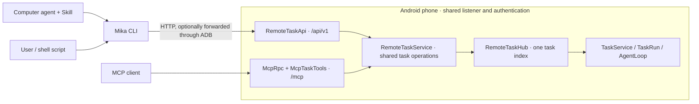

# Computer CLI and Agent Skill

[简体中文](cli.md) | English

> Using Mika from a computer? Start with [Use Mika from a computer](computer.en.md): how to choose between CLI + Skill and MCP, and how to connect.

CLI and MCP are peer entry points backed by the same remote task service on the phone. The CLI calls an ordinary HTTP task API; it needs no MCP SDK, handshake, tool discovery or MCP client configuration. The Skill tells a computer agent how to delegate, handle questions and report actual results. Mika on Android still plans and executes the task.



## Installation and maintenance

See the [CLI / Skill installation guide](computer-install.en.md) for installation, updates, rollback and removal. Normally choose either the CLI or MCP. The phone must support task API v1, first shipped in official APK v0.1.23.

With only the Skill installed, `mika` below means `python3 <skills-directory>/mika/scripts/mika_cli.py` (`py -3` on Windows).

## Connect

ADB mode requires Android platform-tools and either USB or connected wireless ADB. For wireless ADB, this computer must be paired and connected to the phone, which must appear as `device` in `adb devices`. Pairing Mika's built-in helper on the phone does not pair the computer; both also differ from direct LAN access below.

```bash
mika devices --json
mika connect --device SERIAL --json
mika doctor --device SERIAL --json
```

You may omit `--device` when exactly one device is online; the existing ANDROID_SERIAL environment variable is also supported. Multiple devices require a choice, and connection failure never selects a different phone. `connect` runs Mika's official bootstrap script to enable computer access and start the required helper; it does not submit a task. Other commands only read the current connection.

Each invocation reads the current token, port and boot number, allocates its own temporary `adb forward tcp:0` mapping, then removes only that mapping. Tokens stay in process memory; bootstrap output is captured instead of printed. Exiting the CLI leaves the phone service and ongoing tasks running.

The CLI handles forwarding; you do not need the MCP instructions for manually forwarding a fixed port. After reconnecting the cable, make sure the same phone is back in ADB. After a phone reboot or turning off computer access, run `connect` again.

For LAN/private-network access explicitly enabled in the phone's settings:

```bash
mika --url http://PHONE:8765 --token-file /path/to/private-token-file doctor --json
```

The private token file contains only the access token. Use the server origin or `/api/v1` URL, not `/mcp`; URL credentials are rejected. The CLI refuses redirects and ignores ambient HTTP proxies. The server retains its private-network restrictions. Plain LAN HTTP does not encrypt traffic; ADB or a trusted private network can be used.

## Tasks

```bash
mika --device SERIAL task run --goal-file task.txt --json
mika --device SERIAL task status TASK_ID --json
mika --device SERIAL task wait TASK_ID --timeout 45 --json
mika --device SERIAL task answer TASK_ID --text-file answer.txt --json
mika --device SERIAL task steer TASK_ID --text "Only summarize today's messages" --json
mika --device SERIAL task cancel TASK_ID --json
mika --device SERIAL task list --limit 10 --json
```

Use `--goal` / `--text` for simple text, or UTF-8 files for multiline input. A file argument of `-` reads stdin. `run --conversation CONVERSATION_ID` starts another task in an existing remote conversation; `answer` only answers an open question. Existing mcp- conversation IDs remain valid across both interfaces. Their historical prefix does not mean the CLI uses MCP.

`run` returns as soon as a task ID is available. Each `wait` lasts at most 50 seconds and returns on a status change or completion. An existing question or phone handoff is returned immediately. Budget expiry returns the current state without failing, cancelling or resubmitting the phone task. Cancellation's `accepted` is an acknowledgement; query the task and observe cancelled before reporting that it has stopped.

`steer` adds instructions to a `running` remote task without changing its task ID or context. It also accepts `--text-file` (a file or `-` for stdin), up to 4000 characters. `accepted: true` and `message_id` acknowledge inbox delivery only. Query `status` and find the message in `steers`: `received` means queued, `joined` means added to this task's context, and `not_applied` means unused when the task ended or was cancelled. `joined` does not prove successful execution. An action already executing finishes first; steering does not undo past actions.

Queued, paused, question-waiting, phone-handoff and terminal tasks reject steering (409). Use `answer` for questions and the phone for handoff/approvals. Even a race with task completion never starts another task. Do not repeat a write whose response was lost: query the same task, and report uncertainty if no message ID was received and delivery cannot be established. Steering requires the APK's `task_steer` capability; older APKs prompt an update instead of falling back to a new task.

`--json` writes one JSON object to stdout for both success and errors. The default is indented JSON, with errors on stderr. Connection options and `--json` work before or after subcommands. `--request-timeout` controls HTTP timeouts; a wait request has at least its wait budget plus five seconds to receive a response.

| Exit code | Meaning |
| --- | --- |
| 0 | Successful call; a task may still be active or awaiting user action, or cancellation may still be pending. |
| 1 | Explicit API rejection, or a task observed as failed / cancelled. |
| 2 | Input, configuration, connection or protocol incompatibility. |
| 4 | Write outcome unknown; the phone may have accepted it, and it was not retried. |
| 130 | A local read/wait was interrupted; no phone task cancellation was requested. |

A lost write response, server-side write error or Ctrl-C during a write can leave its outcome unknown. Query the known task ID, or inspect recent tasks when no ID was received. Report uncertainty if it cannot be resolved. Reads also have no automatic retries. The phone's remote task index remains in memory, so an app process restart can make old IDs unavailable. This PR does not add task persistence or idempotent submission guarantees.

`doctor` checks connectivity/API and available device state; it explicitly reports model configuration as unverified. It neither invokes a model nor starts a task, and cannot establish real-device task acceptance. Missing `verified` means unknown. Payment confirmations, phone handoff and access to phone-local tasks retain the same boundaries as MCP.

## Browser task desk

```bash
mika ui                      # open the task desk in a local browser
mika ui --device SERIAL --no-open
```

`mika ui` serves a page for this computer only on a random `127.0.0.1` port. It uses the same task commands to start tasks, follow progress, answer questions, add instructions and cancel, and shows Simplified Chinese or English depending on the browser's language. The part of the link after `#` is the session secret for this run; browsers do not send it anywhere. The server also checks Host and Origin and accepts only a fixed set of actions. It is an interactive page for people and does not support `--json`. See [Use Mika from a computer](computer.en.md#task-desk-mika-ui).

## HTTP contract

All paths below are relative to `/api/v1` and use the same Bearer authentication. POST bodies are application/json objects. Errors use HTTP status plus a structured code/message, without MCP envelopes. Unknown fields are rejected.

| Method and path | Input / response |
| --- | --- |
| GET root | API version, server version, capabilities and input limits. |
| GET /device | Read-only device state; 503 if unavailable. |
| POST /tasks | goal and optional conversation; 201 with task ID and state. |
| GET /tasks?limit=10 | Recent remote tasks; limit 1–50. |
| GET /tasks/ID | Current task state. |
| POST /tasks/ID/wait | timeout_s 1–50, default 30; state and changed. |
| POST /tasks/ID/answer | text; returns task_id and accepted. |
| POST /tasks/ID/steer | text; 202 with task_id, message_id and accepted. Only accepts running tasks. |
| POST /tasks/ID/cancel | Empty object; 202 when accepted, 200 for an already-terminal task; returns accepted. |

Business validation errors return 400, missing tasks 404, answers incompatible with the current state 409, and refused starts 503. Authentication, origin and rate-limit policies are shared with `/mcp`. Both adapters use the same remote task index. Clients with the same access authorization can operate on remote tasks across interfaces; phone-local tasks remain inaccessible.

## Development checks

```bash
./gradlew :core:test :core:cliTest :app:testDebugUnitTest :app:assembleDebug
# Python tests alone; use -PmikaPython=/path/to/python3 to select an interpreter
python3 -m unittest discover -s tools/mika/tests -v
```

Pure JVM tests cover the shared service, API/MCP interoperability, authentication, states and existing protocol regressions. `cliTest` (needs Python 3.10+; not part of `check`, run it explicitly) runs the real CLI against the Kotlin HTTP server, checking it only requests `/api/v1`, plus fake-ADB, lost-response, token-rotation, forwarding-cleanup and standalone-Skill tests. No phone or model key is required. Actual wireless disconnects, phone reboot and real agent execution need separate device acceptance; isolated tests do not establish those results.
